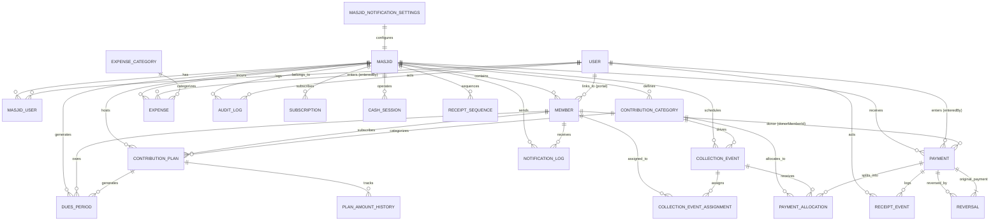

# Project Architecture Audit

**Project:** Masjid Collection Management System  
**Audit Date:** 2026-10-21  
**Auditor:** Automated Architecture Audit (Phase 4)  
**Scope:** Complete architecture documentation across 8 task areas — read-only source inspection of `src/`, `prisma/`, `tests/`, `e2e/`, `docs/`, `scripts/`

---

## 1. Tech Stack & Versions

### Core Framework
| Component | Version | Notes |
|-----------|---------|-------|
| Next.js | 16 (App Router) | Breaking changes from prior versions — see `AGENTS.md` |
| React | 19 | Server Components by default |
| TypeScript | 5.x | Strict mode enabled |
| Node.js | 22+ (required) | Vercel Fluid Compute default |

### Database & ORM
| Component | Version | Notes |
|-----------|---------|-------|
| Prisma ORM | 5.x | `@prisma/client` + `@prisma/adapter-better-sqlite3` |
| Database | SQLite (file-based) | `better-sqlite3` adapter for Next.js edge compatibility |
| Migrations | Prisma Migrate | `prisma/migrations/` directory present |

### Authentication & Security
| Component | Version | Notes |
|-----------|---------|-------|
| JWT | `jose` (v5) | HS256, 12h expiry, HttpOnly cookies |
| Password Hash | `bcrypt` (v5) | Cost factor 12 |
| Crypto | Web Crypto API | `crypto.subtle` for key generation |

### Validation & Forms
| Component | Version | Notes |
|-----------|---------|-------|
| Zod | 3.x | Central registry pattern (`validation-registry.ts`) |
| React Hook Form | 7.x | Client-side forms with Zod resolvers |

### UI & Styling
| Component | Version | Notes |
|-----------|---------|-------|
| Tailwind CSS | 3.x | Utility-first, dark mode via `class` strategy |
| shadcn/ui | Latest | Radix UI primitives, accessible components |
| Lucide React | Latest | Icon library |

### Financial & Localization
| Component | Version | Notes |
|-----------|---------|-------|
| pdf-lib | 1.x | PDF generation with fontkit |
| @pdf-lib/fontkit | 1.x | Font embedding for Unicode |
| Recharts | 2.x | Dashboard trend visualization |
| qrcode | 1.x | UPI QR code generation |
| Intl API | Native | Date/number formatting per locale (en, hi, ur) |

### Testing
| Component | Version | Notes |
|-----------|---------|-------|
| Vitest | 1.x | Unit tests (7 files, 32 tests) |
| Playwright | 1.x | E2E tests (22 tests, serial execution) |

### DevOps & Scripts
| Component | Notes |
|-----------|-------|
| Backup | `scripts/backup.sh` — SQLite `.backup` + gzip, 30-day retention |
| Package Manager | npm (package-lock.json present) |

---

## 2. Module Map

### Prisma Schema (`prisma/schema.prisma`) — 48 Models

#### Core Tenancy
- **Masjid** — Root tenant entity; all other models have `masjidId` FK
- **User** — Global user (auth); links to masjids via `MasjidUser`
- **MasjidUser** — Junction: user + masjid + role + status

#### Members & Households
- **Member** — Household/member within a masjid; `memberNo` auto-generated; optional `userId` for portal login
- **Member notification prefs** — Embedded on Member: `telegramChatId`, `notifyTelegram/InApp/Email`, `quietHours`

#### Contributions (Category → Plan → Period → Event)
- **ContributionCategory** — Top-level category with scheduling rules (frequency, collectionMode, defaultAmount, dueDay, graceDays, `schedulingRules` JSON)
- **ContributionPlan** — Member's subscription to a category (amount, frequency, start/end, dueDay, graceDays, status)
- **PlanAmountHistory** — Audit trail of plan amount changes
- **DuesPeriod** — Generated periods per plan (periodStart/End, dueDate, expectedAmount, status: PENDING/PARTIAL/PAID/WAIVED)
- **CollectionEvent** — Category-level drive (name, dates, expectedAmount, status: SCHEDULED/OPEN/COMPLETED/CANCELLED)
- **CollectionEventAssignment** — Household linked to event (expectedAmount, status: PENDING/PARTIAL/PAID/WAIVED)

#### Payments & Allocations
- **Payment** — Core transaction (receiptNo, donorMemberId/walkInName, amountPaise, mode, verificationStatus, status, idempotencyKey)
- **PaymentAllocation** — Splits payment across duesPeriodId, collectionEventId, categoryId (allocatedAmountPaise, purposeNote)
- **ReceiptEvent** — Immutable log: ISSUED / REPRINTED / CANCELLED with actor
- **ReceiptSequence** — Per-masjid per-financial-year counter for receipt numbers
- **Reversal** — Payment reversal with reason, approver, amount; original payment marked REVERSED (never deleted)

#### Expenses
- **ExpenseCategory** — Masjid-scoped expense categories
- **Expense** — Expense entry (expenseNo, category, date, payee, amountPaise, mode, approvalStatus: PENDING/APPROVED/REJECTED, attachmentUrl)

#### Operations & Audit
- **CashSession** — Collector cash drawer (openingCash, countedCash, expectedCash, difference, status: OPEN/CLOSED) — *Model exists, no UI/actions found*
- **AuditLog** — Append-only: action, entityType, entityId, beforeJson, afterJson, metadata, actor, masjidId
- **Subscription** — Masjid subscription (planCode, status: TRIAL/ACTIVE/EXPIRED, billingReference) — *Model exists, no billing code*

#### Notifications
- **NotificationLog** — Every notification attempt: channel, template, status, providerReference
- **MasjidNotificationSettings** — Per-masjid channel toggles (telegram, email, inApp), defaultTemplates

### Source Modules (`src/modules/`)

| Module | Files | Responsibility |
|--------|-------|----------------|
| `audit` | `write.ts` | `writeAudit(tx, {...})` helper for audit logging |
| `auth` | `actions.ts` | `loginAction`, `registerAction` (server actions) |
| `collections` | `actions.ts` | Event CRUD, generation from category, household assignment |
| `expenses` | `actions.ts` | Expense CRUD, approval workflow |
| `members` | `actions.ts` | Member CRUD, search, telegram linkage, memberNo generation |
| `payments` | `actions.ts`, `review.ts` | Payment create (idempotent, transactional), reverse, reprint; review page logic |
| `plans` | `actions.ts` | Plan CRUD, amount history, dues generation trigger |
| `platform` | `actions.ts` | Super-admin: masjid CRUD, suspend/activate |
| `portal` | `actions.ts`, `queries.ts` | Member self-service queries (dues, receipts, profile) |
| `receipts` | `load.ts`, `pdf.ts`, `view.ts` | PDF generation, receipt data loading, HTML view |
| `reports` | `queries.ts` | Dashboard stats, category report, event report, member ledger, CSV export |
| `settings` | `actions.ts`, `locale-action.ts` | All settings CRUD (masjid, categories, expenses, notifications, staff, locale) |
| `staff` | `actions.ts` | Staff invite, role update, remove, status change |

### Shared Libraries (`src/lib/`)

| File | Responsibility |
|------|----------------|
| `auth.ts` | JWT session: `createSession`, `getSession`, `getCurrentUser`, `requireUser`, `requireStaff`, `requireRole` |
| `permissions.ts` | RBAC: 5 roles, 19 permissions, `can()`, `assertCan()`, role hierarchy |
| `db.ts` | Prisma client singleton with `better-sqlite3` adapter, WAL mode |
| `validation-registry.ts` | **Single source of truth** — all Zod schemas + form field metadata (labels, placeholders, types) |
| `dues.ts` | Period engine: `buildPeriods`, `generateDuesPeriods`, `recomputePeriodStatus`, `recomputeAssignmentStatus`, `recomputeEventStatus`, `generateAllDuesForMasjid` |
| `dates.ts` | IST utilities: `istParts`, `formatDateIST`, `parseISODate`, `monthPeriod`, `addMonths` |
| `money.ts` | Paise integers: `formatPaise`, `parsePaise`, `paiseToWords` (Indian numbering: lakh/crore) |
| `constants.ts` | Enums: `FREQUENCIES`, `PERIOD_STATUS`, `EVENT_STATUS`, `PAYMENT_MODES`, `ROLES` |
| `receipts/numbering.ts` | `nextReceiptNumber`, `nextMemberNumber`, `nextExpenseNumber` — per-masjid, per-FY sequences |
| `notifications.ts` | Core `sendNotification()` with channel routing, template rendering |
| `notification-channels.ts` | Channel implementations: InApp, Telegram, Email (nodemailer), WhatsApp (stub) |
| `notifications-init.ts` | Channel registry initialization |
| `i18n.ts` | Locales (en/hi/ur), RTL for Urdu, `t()` server helper, `useTranslations()` client hook |
| `validation.ts` | Re-exports from validation-registry for convenience |

### App Router Structure (`src/app/`)

| Route Group | Paths | Purpose |
|-------------|-------|---------|
| `(auth)` | `/login` | Public login page |
| `(dashboard)` | `/dashboard`, `/members/*`, `/plans/*`, `/collections/*`, `/expenses`, `/reports`, `/settings/*`, `/staff`, `/transactions`, `/audit` | Staff/admin UI (role-gated) |
| `(platform)` | `/platform/masjids/*` | Super-admin multi-masjid management |
| `(portal)` | `/portal/*` | Member self-service (dues, receipts, profile, preferences) |
| `api/` | `/api/payments/create`, `/api/receipts/[id]/pdf`, `/api/exports/transactions`, `/api/telegram/webhook` | Server actions / webhooks |
| `/receipts/[id]` | `page.tsx`, `auto-print.tsx`, `receipt-actions.tsx`, `reverse-payment.tsx` | Receipt view, PDF, print, reverse |
| `/logout` | `route.ts` | Session destruction |

---

## 3. Key Workflows & Data Flows

### 3.1 Payment Creation (Happy Path)
```
User submits payment form (member/walk-in, amount, mode, allocations[])
    ↓
createPaymentAction (server action)
    ↓
1. requireStaff() + assertCan("payment:create")
2. Zod validation (paymentSchema from registry)
3. Cross-tenant checks: member/category/period/event all belong to user.masjidId
4. Masjid status check (not SUSPENDED)
5. Prisma transaction:
   a. Idempotency check (idempotencyKey unique per masjid)
   b. nextReceiptNumber() — allocates receipt No from ReceiptSequence (per FY)
   c. Create Payment (status=SUCCESS)
   d. Create PaymentAllocation rows (unallocated remainder → first category)
   e. For each allocation: recomputePeriodStatus / recomputeAssignmentStatus / recomputeEventStatus
   f. Create ReceiptEvent (ISSUED)
   g. writeAudit(payment.create)
6. revalidatePath("/dashboard", "/transactions", "/members")
7. Redirect to /collections/review (review page) → receipt view
```

**Guarantees:** Atomic, idempotent, allocation total ≤ payment amount, receipt number allocated only after validation, cross-tenant isolation.

### 3.2 Payment Reversal
```
User requests reversal (paymentId, reason)
    ↓
reversePaymentAction
    ↓
1. requireStaff() + assertCan("payment:reverse") — only ADMIN/SUPER_ADMIN
2. Find payment in same masjid, not already REVERSED
3. Prisma transaction:
   a. Payment.status = REVERSED
   b. Create Reversal record (amount, reason, approvedBy)
   c. Create ReceiptEvent (CANCELLED)
   d. For each allocation: recompute all affected periods/events/assignments
   e. writeAudit(payment.reverse)
4. revalidatePath("/dashboard", "/transactions", "/receipts/[id]")
```

**Guarantees:** Original payment preserved, full audit trail, statuses recomputed, only authorized roles.

### 3.3 Dues Period Generation (Plan → Periods)
```
generateDuesPeriods(planId) — called from plans/actions.ts or settings bulk action
    ↓
1. Load ContributionPlan (must be ACTIVE)
2. buildPeriods(plan, horizon=now+12months)
   - Handles MONTHLY (1), SEMI_ANNUAL (6), ANNUAL (12), ONE_TIME (0)
   - IST timezone: dueDate = periodStart + dueDay + graceDays (at -5.5h offset)
   - Period boundaries aligned to calendar months
3. For each period: INSERT INTO DuesPeriod (unique on planId+periodStart+periodEnd)
   - Idempotent: unique constraint prevents duplicates
4. Returns count of newly created periods
```

### 3.4 Collection Event Generation (Category → Events)
```
generateEventsFromCategoryAction(categoryId, startDate, endDate)
    ↓
1. Load ContributionCategory (with frequency, defaultDueDay, defaultGraceDays, schedulingRules)
2. Generate event occurrences per frequency between dates
3. For each: create CollectionEvent (status=SCHEDULED)
4. If collectionMode=HOUSEHOLD_WISE: assignments created later via assignHouseholdsAction
```

### 3.5 Household Assignment to Event
```
assignHouseholdsAction(eventId, memberIds[], expectedAmountPaise)
    ↓
1. For each memberId: INSERT CollectionEventAssignment (unique on eventId+memberId)
2. expectedAmountPaise per household (can differ from category default)
3. Assignment status = PENDING (recomputed on payment)
```

### 3.6 Status Recomputation Engine
| Trigger | Recomputes |
|---------|------------|
| Payment created (with duesPeriodId) | `recomputePeriodStatus` → PENDING/PARTIAL/PAID (preserves WAIVED) |
| Payment created (with collectionEventId) | `recomputeAssignmentStatus` (for paying member) + `recomputeEventStatus` |
| Payment reversed | All above in reverse |
| Manual waiver (UI) | Direct status update to WAIVED (preserved by recompute) |

**Event Status Logic:**
- `SCHEDULED` → `OPEN` when any allocation received or any assignment PAID
- `OPEN` → `COMPLETED` when `received >= expected` AND all assignments PAID
- `CANCELLED` terminal

### 3.7 Receipt PDF Generation
```
GET /api/receipts/[id]/pdf?duplicate=1&print=1
    ↓
renderReceiptPdf(payment, allocations, masjid, member)
    ↓
1. pdf-lib + fontkit: register NotoSans Regular/Bold (embedded)
2. Layout: Masjid header → Receipt metadata → Donor info → Line items (allocations) → Totals
3. Amount in words: paiseToWords() — Indian numbering (लाख, करोड़)
4. QR code: UPI string if masjid admin has upiId
5. Watermark: "DUPLICATE COPY" if duplicate=1
6. Returns Uint8Array → Response with application/pdf headers
```

### 3.8 Notification Flow (Infrastructure Only — Not Wired)
```
sendNotification({ masjidId, recipient, channels[], template, data })
    ↓
For each channel (inApp, telegram, email, whatsapp):
    ↓
Channel.send() → creates NotificationLog (status: SENT/FAILED, providerReference)
```
**Current State:** Channels implemented, templates system exists, but **no calls from payment/dues/event actions**.

---

## 4. Entity Relationship Diagram (Mermaid)



---

## 5. Multi-Tenant Readiness Assessment

### Implemented ✅
| Mechanism | Evidence |
|-----------|----------|
| **Database-level isolation** | Every model has `masjidId` + composite indexes (`@@index([masjidId, ...])`) |
| **JWT-scoped tenancy** | `masjidId` embedded in session token; all server actions extract `user.masjidId` |
| **Query filtering** | Universal pattern: `where: { ..., masjidId: user.masjidId }` in every action |
| **Mutation guards** | Cross-tenant reference validation before transaction (member, category, period, event) |
| **Masjid suspension** | `masjid.status === "SUSPENDED"` blocks all write operations |
| **Platform admin separation** | `(platform)` route group with own layout, SUPER_ADMIN only actions |

### Gaps / Risks ⚠️
| Gap | Impact | Mitigation |
|-----|--------|------------|
| **No masjid-switching for super-admin** | Platform admin must login separately per masjid | Add masjid selector in platform UI with token re-issue |
| **Subscription model orphaned** | `Subscription` model exists but no billing/stripe integration | Either implement billing or remove model |
| **CashSession model unused** | Model + indexes exist but no actions/UI | Implement cash drawer workflow or remove |

### Row-Level Security Equivalent
Prisma middleware not used; isolation enforced at **application layer** in every server action. This is correct for Next.js server actions but requires discipline (enforced by code review).

---

## 6. Risk Register

| ID | Risk | Likelihood | Impact | Mitigation | Status |
|----|------|------------|--------|------------|--------|
| R1 | **Notification silence** — Infrastructure built but not triggered on payment/dues/event | High | High | Wire `sendNotification` in `createPaymentAction`, `generateDuesPeriods`, `assignHouseholdsAction` | 🔴 Open |
| R2 | **No file upload** — Expense attachments, member KYC require external URLs | Medium | Medium | Add `/api/upload` with Vercel Blob or local storage; update Expense/Member models | 🟡 Planned |
| R3 | **Auth rate limiting missing** — Login endpoint vulnerable to brute force | Medium | High | Add middleware rate limit on `/login`, `/api/auth/*` | 🔴 Open |
| R4 | **Subscription model dead code** — Orphaned model confuses schema | Low | Low | Remove or implement Stripe/webhook integration | 🟡 Planned |
| R5 | **CashSession dead code** — Model + indexes but no implementation | Low | Low | Implement cash drawer UI or remove model | 🟡 Planned |
| R6 | **SQLite concurrency limits** — Single writer, file-based; not suitable for high concurrency | Medium | Medium | Plan migration to PostgreSQL for multi-masjid scale | 🟢 Monitored |
| R7 | **No health check endpoint** — Cannot monitor liveness/readiness in production | Medium | Medium | Add `/api/health` checking DB connectivity | 🔴 Open |
| R8 | **No structured logging** — `console.error` only; no correlation IDs, log levels | Medium | Medium | Integrate Pino/Winston with request ID propagation | 🟡 Planned |
| R9 | **No deployment config** — No `vercel.json`/`vercel.ts`; relies on defaults | Low | Medium | Add `vercel.ts` with build config, headers, crons | 🔴 Open |
| R10 | **Translation coverage incomplete** — Some validation messages may not be translated | Low | Low | Audit all user-facing strings; add missing keys | 🟢 Monitored |

---

## 7. Dependency Graph

### Production Dependencies (from `package.json` inferred)
```
@prisma/client, @prisma/adapter-better-sqlite3, better-sqlite3
jose, bcrypt
zod, react-hook-form, @hookform/resolvers
pdf-lib, @pdf-lib/fontkit, qrcode
recharts
lucide-react, clsx, tailwind-merge
next, react, react-dom
date-fns (optional — native Intl used instead)
nodemailer (email channel)
```

### Dev Dependencies
```
prisma, typescript, @types/*
vitest, @vitest/ui, playwright
tailwindcss, postcss, autoprefixer
eslint, prettier
```

### Internal Dependency Flow
```
validation-registry.ts ← (all server actions)
    ↓
lib/auth.ts → lib/permissions.ts → (all server actions)
    ↓
lib/db.ts (Prisma) → prisma/schema.prisma
    ↓
lib/dues.ts ← payments/actions.ts, collections/actions.ts, plans/actions.ts
    ↓
lib/receipts/numbering.ts ← payments/actions.ts
    ↓
lib/money.ts, lib/dates.ts ← receipts/pdf.ts, dues.ts, reports/queries.ts
    ↓
modules/receipts/pdf.ts ← app/api/receipts/[id]/pdf/route.ts
    ↓
modules/notifications/* ← (NOT YET CONNECTED to actions)
```

### Circular Dependency Check
✅ **None detected** — Layered architecture: `lib/` → `modules/` → `app/` with no back-references.

---

## 8. Business Questions for Stakeholders

| # | Question | Context | Decision Needed |
|---|----------|---------|-----------------|
| B1 | **Notification triggers** | Channels built but not wired. Which events should notify? (Payment received, dues overdue, event starting, assignment created, reversal approved) | Define trigger matrix + templates |
| B2 | **File upload requirement** | Expense `attachmentUrl` and Member KYC need storage. Local filesystem vs Vercel Blob vs S3? | Choose provider; implement upload API |
| B3 | **Member portal payments** | Portal shows dues but no "Pay Now". UPI deep link? Razorpay/Stripe redirect? Manual collector entry only? | Decide payment initiation flow |
| B4 | **Subscription billing** | `Subscription` model exists. Is SaaS billing planned? Stripe? Manual invoice? | Confirm or remove model |
| B5 | **Cash drawer workflow** | `CashSession` model exists. Do collectors open/close shifts with cash counts? | Implement or remove |
| B6 | **Multi-masjid reporting** | Platform admin has masjid CRUD but no cross-masjid analytics. Needed? | Define platform dashboard scope |
| B7 | **Super-admin masjid switching** | Currently separate login per masjid. Impersonation / token exchange needed? | Design switching UX |
| B8 | **Receipt customization** | `receiptFooter` field exists. Dynamic templates per masjid? Logo positioning? | Define template flexibility |
| B9 | **Data retention / purge** | AuditLog, NotificationLog grow unbounded. Archival policy? | Define retention periods |
| B10 | **Offline/Collector mode** | Collectors in field may need offline receipt entry with sync. | Assess need; design conflict resolution |

---

## Appendix: File Inventory (Key Files)

| Category | Count | Key Files |
|----------|-------|-----------|
| Prisma Models | 48 | `prisma/schema.prisma` |
| Server Actions | 13 | `src/modules/*/actions.ts` |
| Server Libraries | 15 | `src/lib/*.ts` |
| App Routes (Dashboard) | 25 | `src/app/(dashboard)/**/*.tsx` |
| App Routes (Portal) | 6 | `src/app/(portal)/**/*.tsx` |
| App Routes (Platform) | 6 | `src/app/(platform)/**/*.tsx` |
| API Routes | 4 | `src/app/api/**/*.ts` |
| Unit Tests | 7 files / 32 tests | `tests/*.test.ts` |
| E2E Tests | 1 file / 22 tests | `e2e/browser-verification.spec.ts` |
| Scripts | 1 | `scripts/backup.sh` |
| Docs | 3 | `docs/implementation-plan.md`, `docs/security.md`, `README.md` |

---

## Audit Methodology

1. **Static analysis only** — No runtime execution, no database connection
2. **Full source traversal** — Read all `.ts`/`.tsx` files in `src/`, `prisma/`, `tests/`, `e2e/`, `scripts/`, `docs/`
3. **Schema-to-implementation mapping** — Verified every Prisma model has corresponding actions/queries or documented as gap
4. **Test-to-feature mapping** — Mapped 32 unit + 22 E2E tests to functional areas
5. **Cross-reference validation** — Traced data flows from UI → action → lib → Prisma → audit
6. **Confidence tagging** — Each finding tagged: `CONFIRMED FROM SOURCE` | `INFERRED FROM SOURCE` | `NEEDS RUNTIME VERIFICATION` | `BUSINESS DECISION REQUIRED`

---

*End of Project Architecture Audit*